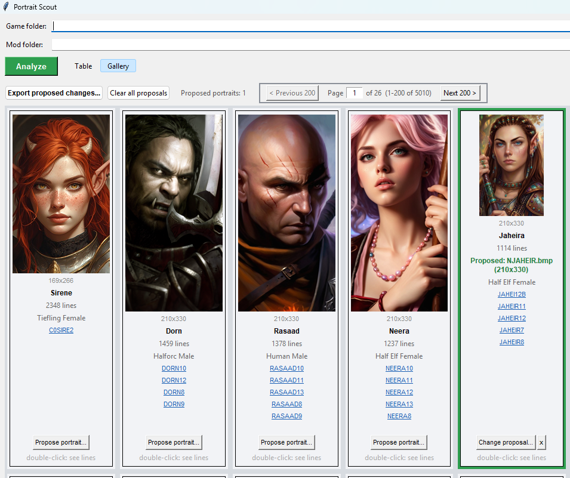
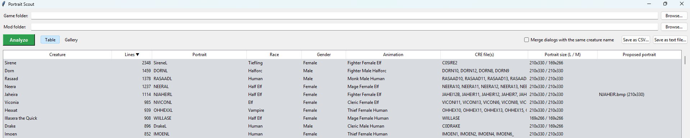

# Portrait Scout

Finds the speaking creatures of an Infinity Engine mod - or of a whole game install (BG1EE, SoD, BG2EE, EET, IWDEE, and classic BG1, BG2, IWD) - and shows who talks, how much, what portrait each one has, and where in the game they turn up. Then it helps you fill the gaps: propose portraits, make new ones with an image generator, and export the result as a WeiDU mod.

It only **reads** your game folder. Nothing is installed, changed or deleted there.

| Creature | Lines | Portrait | Race | Gender | Animation | CRE file(s) | Area(s) |
|---|---|---|---|---|---|---|---|
| Skie | 21 | SKIEL | Human | Female | Thief Female Human | SKIE | AR0700 Docks District |
| Urnn Indigospit | 11 | L#SSMAG | Human | Male | Mage Male Human | L#SSMAG | AR1203 Firkraag's Dungeon |



**What it is for:** a portrait mod author, or anyone who wants to see which speakers in a mod have no portrait, which ones share one, and which creature file to open in NearInfinity.

- **Who speaks, and how much** - every creature with dialog, with its line count, and every line readable (and playable, if it has a voice).
- **Portraits as they are** - large and small, with their sizes, so duplicates, low-resolution pictures and gaps are obvious.
- **Where they are** - the areas each creature appears in, placed by the area, made by a spawn point, or created by its script.
- **With or without the mod installed** - it can read the mod's own files instead of matching text against the installed game, which also gets short lines ("Yes.") attributed to the right speaker.
- **Portraits in, portraits out** - propose a picture for a creature, or generate one, then export the lot as a ready-to-install WeiDU mod.

## Requirements

- Python 3.8+ with tkinter (included in the normal Windows/macOS installers; Linux: `python3-tk`).
- A game folder (contains `chitin.key`) with the mod installed via WeiDU, plus the mod's own folder (`.tp2`, `.tra`, `.d` files). Not IWD2 or Planescape: Torment.
- Optional: [ffmpeg](https://ffmpeg.org) on PATH to play compressed sounds (WAVC/ACM and Ogg). Plain WAV sounds play without it. Playback uses `winsound` on Windows, `afplay` on macOS, `paplay`/`aplay` on Linux.
- Optional: `pip install pillow` to preview JPG and other formats for proposed portraits (PNG, GIF and BMP work without it), and for slightly sharper generated portraits (Portrait Scout offers to install it).

## Use

1. Copy `portrait_scout.py` into the game folder, open a command prompt there, run `python portrait_scout.py`. The game folder is pre-filled; the last one used is remembered.
2. Pick the **Mod folder**. Leave it empty, or pick the game folder, to list the whole install.
3. Press **Analyze** (can take a minute or two on a large install).

Then four tabs:

| Tab | What it holds |
|---|---|
| **Table** | Every speaker, sortable, with lines, portrait, race, gender, animation, creature files and areas. |
| **Gallery** | The same creatures as cards with their portraits, 200 to a page. |
| **Generate** | Make a portrait for the selected creature, or any portrait at all, with an image generator you set up yourself. |
| **Proposals** | Everything you have chosen a picture for, and the two exports. |

4. In **Table** and **Gallery**: click table headers to sort. Clicking a creature name or a CRE name copies it (table, gallery and lines window), ready to paste into NearInfinity.
   **Search** (or **Ctrl+F**) filters both views as you type, by name, CRE file, portrait, race, gender, animation or proposed image. Several words must all match. **x** clears it. Saving and exporting always include every creature.
   In the gallery, scroll with the mouse wheel, **Up/Down**, **Page Up/Down** or **Ctrl+Home/End**. It shows 200 creatures per page: use **Previous/Next** or type a page number and press **Enter**.
5. **Double-click** a creature to see its portrait and lines (**Copy all lines** copies them all, **Copy** on a line copies just that one) and, for speakers that needed explaining, "Where this comes from". Lines with a voiced sound show its name and a **▶ Play** button (press again to stop). The **Search** box there (or **Ctrl+F** in that window) filters the lines by strref, sound name or text. Long lists are shown 200 lines per page (**Previous/Next**, or type a page number and press **Enter**).
6. A `<ModName>-creatures.txt` report is saved next to the script. **Save as text file...** and **Save as CSV...** save elsewhere.

Dialogs of the same NPC (e.g. a joined-party dialog, or several creature files of one character) are shown as one row: same name, and a shared creature file or portrait, or no difference in race, gender and animation. **Merge same names** forces this by name alone; leave it off if different creatures share a name, such as two zombies - though identical ones (several plain "Peasant" creatures) still merge, and their Area(s) column is the giveaway.

Portraits show their resolution everywhere. **Right-click** any portrait to save the image.

## Reading the mod's own files (experimental)

Tick **Read the mod's own files** (marked *install not needed*) to work from the mod's `.d`, `.tra`, `.tp2`, `.cre`, `.baf` and `.are` files instead of matching its text against the installed game. The mod does **not** have to be installed; both folders are still needed, because the game folder is what names the NPCs the mod only adds lines to.

- Every line comes with its speaker, so short stock lines ("Yes.") are no longer credited to the wrong creature, and all components of the mod are counted, installed or not.
- The game folder names the NPCs the mod only adds lines to (Imoen, Jaheira...). It uses the game's party tables and scripts, the installers of other mods in the game folder, and, if `WeiDU.log` shows EET is installed, EET's own name table.
- The lines window shows the source file of each line instead of a strref, and "Where this comes from" says how each dialog was tied to its creature. Dialogs of NPCs from mods that are not installed stay `Unknown (DIALOGNAME)`.
- Portraits are shown as the game has them now (another mod may have replaced the mod's own). **Show mod's own portraits only** switches to the mod's own pictures.
- Takes about a minute on a large install. `tutu` and `bgt` folders of a mod are skipped.

## Generating portraits (optional, experimental)

The **Generate** tab, next to Table and Gallery, works on one creature at a time: the one selected in the table, or the one whose **Generate...** (gallery card) or **Generate portrait...** (lines window) you pressed.

> **No image generator and no models come with Portrait Scout.** They are many gigabytes and separately licensed, so they are not in this repository. Portrait Scout only builds the prompt, sends it, and turns the picture into a game portrait. Without a generator everything else still works, and the Generate tab shows the steps below with the links as buttons.

### Setting up the generator (once, after cloning)

The Generate tab shows these steps with the links as buttons, so you can also just open it and follow along. The suggested recipe is a private copy of Forge in an `engine` folder next to `portrait_scout.py` (wherever that is - nothing is hard-coded). Windows, NVIDIA. [generator/README.md](generator/README.md) has the longer version, including how to change the look and how to drive a generator of your own.

**What it needs:** about 16 GB of disk, and a graphics card with 8 GB or more of memory for comfortable use; the NF4 model is quantised to four bits so [6 GB cards can run it](https://huggingface.co/lllyasviel/flux1-dev-bnb-nf4), more slowly, and Forge moves what does not fit to system memory. On an 8 GB card a 648 x 1024 picture at 25 steps takes roughly ten seconds once the model is loaded; the first picture after starting the engine takes a few minutes while the model loads. A different model changes all of this, and these numbers will age.

1. Download [`webui_forge_cu121_torch231.7z`](https://github.com/lllyasviel/stable-diffusion-webui-forge/releases/download/latest/webui_forge_cu121_torch231.7z) (1.7 GB), Forge's Windows one-click package - the build this was written against. The [releases page](https://github.com/lllyasviel/stable-diffusion-webui-forge/releases) has other CUDA/Torch builds, and the [Forge page](https://github.com/lllyasviel/stable-diffusion-webui-forge) explains them and unpack it into `PortraitScout\engine`, so you get `engine\webui\` and `engine\system\`, with `run.bat` in `engine\`.
2. Run `engine\update.bat` once, then `engine\run.bat` once and wait for the Forge page to open in your browser. That proves it works; close it again.
3. Put `flux1-dev-bnb-nf4-v2.safetensors` (11.5 GB, from [lllyasviel/flux1-dev-bnb-nf4](https://huggingface.co/lllyasviel/flux1-dev-bnb-nf4), non-commercial licence) in `engine\webui\models\Stable-diffusion\`, and, optional but recommended, `BG_Portrait.safetensors` (38 MB, [Baldur's Gate 2 Portrait Style Flux](https://civitai.com/models/2071031/baldurs-gate-2-portrait-style-flux)) in `engine\webui\models\Lora\`. With no LoRA in that folder the **LoRA** box beside the Style is hidden and the `<lora:...>` part is dropped from the prompt, so everything still works - the model paints alone.
4. Press **Check again** in the Generate tab. From then on Portrait Scout starts and stops the generator itself, without a window and without opening the Forge page.

**Or use a generator you already run** - Forge, Automatic1111, SD.Next, one on another machine: none of the above is needed. In **Generator settings** put its address in and turn "start it for me" off. Any model works: name the checkpoint there, and write the prompts to suit it. Links go stale; the pieces are replaceable, which is the point of keeping them out of the repository. [generator/README.md](generator/README.md) has the details.

- **Description** is filled in from the creature's gender, race and animation type; edit it freely (**Reset** restores it), and add anything else there: scar, hair, build, mood. **⤢** opens a roomier box for either field.
- **Background** holds what is behind the head, prefilled from your settings. Every style that has `{background}` in it uses this, so one change covers them all; empty it and the sentence about the background drops out of the prompt.
- **Candidates** is how many pictures one press of **Generate** makes. **Style** picks one of the looks in `generator/settings.json`: **BG2 framing, light LoRA** asks for a head that fills the frame, the way the game's own portraits are framed, so little or no cropping is needed; **BG2 framing** is the same on the larger 292 MB [Baldur's Gate 1-2 Portrait Style](https://civitai.com/models/1323620/baldurs-gate-1-2-portrait-style) LoRA, an extra download; **Painterly** is wider and meant to be cropped. The **LoRA** box beside the Style turns the `<lora:...>` part off, which can matter for a creature with features of its own - horns, green skin - that a LoRA tends to paint away. Each look brings its own Head zoom. **Copy prompt** gives you the prompt for any other image generator.
- **Prompt** opens the words actually sent to the engine. Edit them and press **Generate** to try them out; **Save** keeps them in `generator/settings.json`, **Save as new style...** keeps them as a style of your own, **Revert to baseline** puts a built-in style back the way it came. `{character}` is replaced by the description plus your extra details, `{subject}` by the short form.
- A progress bar shows the engine starting and each picture being made. Click a candidate to see it full size; right-click to save a copy.
- **Use this** crops and shrinks the picture to a game portrait and makes it the proposed portrait. The row above the candidates sets what that portrait is: **169x266** for a speaker portrait, **210x330** for the standard large one, or anything you type, and **Head zoom** for how close the crop is (1 = the whole picture, which is already a portrait's shape). Above 1 a yellow box on each candidate shows what will be kept; change the zoom and press **Use this** again to re-crop without generating again.
- **Discard** deletes a candidate and the `.bmp` copies made from it, **Discard all** every picture made for that creature. Until then candidates are kept in `generated/<mod>/` and shown again the next time.
- **Image engine**: **Start** and **Stop** it by hand, or just press Generate. **Forge...** opens the running generator's own page in a browser, to try things there directly. **Keep open** leaves the generator running after Portrait Scout closes, so the next session does not wait for the model to load again (a minute or more); it holds graphics memory until you press **Stop**, here or the next time you open Portrait Scout. With it off, the generator is closed with Portrait Scout.
- With no creature selected the tab makes plain portraits: pick **Race**, **Gender** and **Class** (Human, Male, Fighter to begin with) or type your own description. **Unselect**, next to a creature's name, switches to that mode. Pictures made this way are saved but not proposed for anybody.
- **Generator settings** holds the address of the generator, the command that starts it, the model, picture size, steps and sampler. Nothing else needs editing to use a generator of your own.

## Proposing portraits

Press **Propose portrait...** on a gallery card or in the lines window and pick an image. It shows with a green border; **x** removes it, **Clear all proposals** removes all. **Export proposed changes...** writes a to-do list:

```
B!ASTER.CRE  Aster -> BB12020.bmp   [now: none]
SKIE.CRE  Skie -> BB12021.bmp   [now: SKIEL]
```

One line per creature file. Proposals are remembered per mod.

The picked image is checked, with warnings you can ignore, for: a name over 8 characters or with characters a resref can't contain; not a BMP (24-bit or 8-bit are fine); an unusual shape (standard portraits are 210x330, 169x266 and 54x84).

The to-do list changes nothing by itself. Each line also lists the areas the creature appears in.

### Create mod

**Create mod...** turns the proposals of the thing you are looking at into a ready-to-install WeiDU mod. It asks for a name and writes `mod\<name>\` next to `portrait_scout.py`, with a copy of WeiDU beside it (taken from your game folder, where every installed mod has one). Creating it again with the same name updates that mod; another name starts a new one, and another analysis exported into the same name is added as a second set:

```
mod/
  setup-my_portraits.exe        a copy of WeiDU from your game folder
  my_portraits/
    setup-my_portraits.tp2      the installer
    readme.txt                  what it is, how to install it, what is in it
    portraits.txt               every portrait: set, creature file, picture, creature, areas
    my_portraits.ini            so Project Infinity lists it
    portraits/blackhearts/      b!aster.bmp ...  portraits.txt
    portraits/bg1aerie/         ...
```

- As in the HPS portraits mod, each picture is named after its creature file and written into both portrait slots of the creature. Proposals must be `.bmp` (generated ones are; a `.png` is converted if the generator folder is present).
- Every set (one per analyzed mod) is its own choice in the installer, offered twice: give the portraits to every creature listed, or only to creatures that have no portrait. Creature files that are not in the game are skipped, so a set installs even without the mod it was made for.
- To change what is installed, edit `portraits/<set>/portraits.txt` (creature file, picture, creature, areas) and export again, or edit the `.tp2` by hand.
- To install: copy the folder and the `setup-<name>.exe` into the game folder and run it. Portrait Scout itself never changes the game.

## Columns



- **Lines**: NPC lines the creature speaks (player replies excluded).
- **Portrait**: large portrait name, or `(none)`, `(file missing)`, `(creature not found)`.
- **Race / Gender / Animation**: from the creature file and the game's `race.ids` / `animate.ids`.
- **Area(s)**: the maps the creature appears in (code, plus the name for areas on a world map): placed by the area file, made by one of its spawn points, or created by the area's own script. Creatures that only appear through a dialog, cutscene or another script have none. The lines window ("Where this comes from"), the CSV and the to-do list have the full list.
- **CRE file(s)**: creature files sharing the dialog. **Bold** (in `[brackets]` in the table) means the mod ships, names, or matches the name of that file; no clue means none is bold.
- **Proposed portrait**: your proposal (table only).

The text report also lists portraits shared by several creatures and how many have none.

## Command line

```
python portrait_scout.py --cli "C:\Games\BG2EE" "C:\Games\BG2EE\MyMod" --out creatures.txt --csv creatures.csv
```

Add `--merge-names` to merge same-named creatures. Use the game folder as the mod folder for the whole install.

```
python portrait_scout.py --source "C:\Games\BG2EE\MyMod" --game "C:\Games\BG2EE" --out speakers.txt
```

prints the speakers read from the mod's own files.

## How it works

It reads `chitin.key`, the archives, override and `dialog.tlk` directly. Every string in the mod's `.tra`, `.d`, `.baf`, `.tp2` and similar files is looked up in `dialog.tlk`; matches that are NPC lines are counted for the creature owning the dialog. Short stock lines ("Yes.") are only counted inside the mod's own dialogs. Whole-install mode counts every NPC line.

## Notes

- The mod must be installed in the chosen game folder, or the tool says so.
- Matching is by text: accurate, not perfect. Unlinked speakers show as `Unknown (DIALOGNAME)`, and the lines window and CSV `notes` column explain what is known.
- Only plain (uncompressed) archives are read, as in the Enhanced Editions.
- The gallery pages 200 creatures at a time and always shows at least 4 per row (a narrow window gets a sideways scrollbar). The table and text file show all creatures.
- Folders and proposals are stored in `portrait_scout.settings.json` next to the script; delete it to reset.
